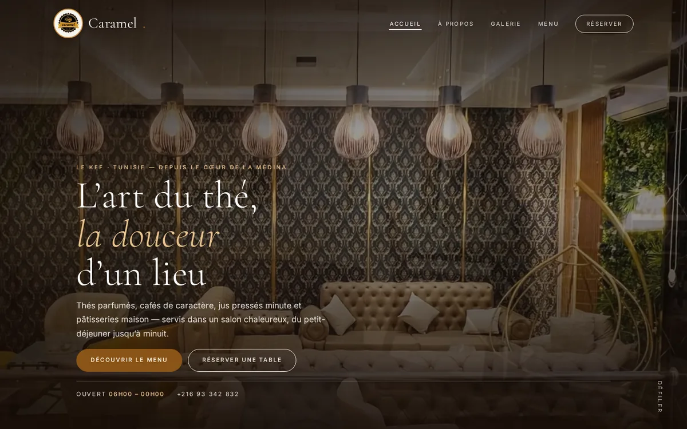
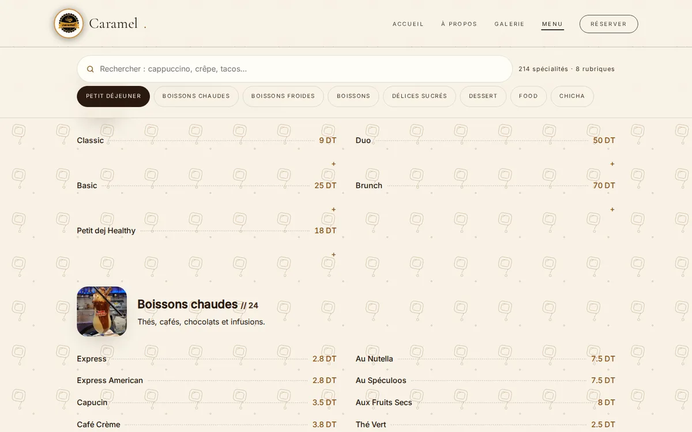
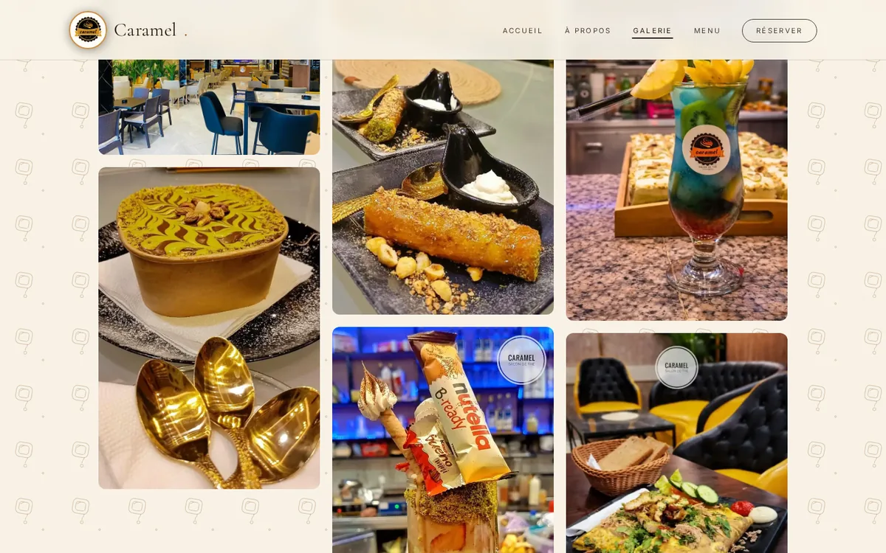

# Salon de Thé Caramel — Le Kef

A five-page French website for **Salon de Thé Caramel**, a tea salon in Le Kef,
Tunisia. Static HTML, CSS and JavaScript — no framework, no build step and no
runtime dependencies.

> **Client project — not currently deployed.** The name, logo, photographs, menu,
> prices and contact details belong to the salon. They are published here for
> portfolio review; confirm everything with the owner before any public launch.



## Pages

| Page | What it contains |
| --- | --- |
| [`index.html`](index.html) | Home: video hero, introduction, gallery preview, menu preview and anniversary-space section |
| [`prop.html`](prop.html) | About the salon and its atmosphere |
| [`gallery.html`](gallery.html) | **52 photos** arranged in **21 staggered scenes**, with a keyboard- and touch-accessible lightbox |
| [`m.html`](m.html) | Full menu — **214 items in 8 categories** — with live search, a sticky category rail and a result counter |
| [`resrv.html`](resrv.html) | Anniversary reservation form for up to 12 guests |

| Menu | Gallery |
| --- | --- |
|  |  |

## What is included

- **214 menu items across 8 categories**: breakfast, hot drinks, cold drinks,
  drinks, sweet treats, desserts, food and chicha — with prices in Tunisian dinars.
- **Live menu search** that filters items as you type, searches descriptions, hides
  empty categories and reports the result count. Collapsible descriptions keep long
  ingredient lists readable.
- **Sticky category navigation** that highlights the current section and scrolls
  horizontally on mobile, with mouse-drag support on desktop.
- **52-photo gallery** built from WebP files and 800 px thumbnails, with an
  asymmetric 12-column layout, lazy loading and a lightbox supporting keyboard
  arrows, Escape and touch swipe.
- **Reservation flow** that posts to a configurable endpoint, or opens WhatsApp with
  the request already written when no endpoint is configured. Includes a same-tab
  fallback when pop-ups are blocked.
- **Brand and local-business metadata**: Schema.org `CafeOrCoffeeShop`, Open Graph
  tags, favicons, Apple touch icon and a PWA manifest.
- **Responsive, motion-aware UI**: mobile navigation, sticky call-to-action bar,
  reduced-motion handling, self-hosted fonts and responsive WebP imagery.

## Tech stack

`HTML5` · `CSS3` · `vanilla JavaScript` · `Python` image tooling

No package manager, framework, bundler or backend is required.

## Run locally

From the project folder:

```bash
python3 -m http.server 8000
```

Open <http://localhost:8000>. Any static file server works.

## Project structure

```text
.
├── index.html               # Home
├── prop.html                # About
├── gallery.html             # Photo gallery
├── m.html                   # Full menu
├── resrv.html               # Anniversary reservation
├── assets/
│   ├── site.css             # Shared design system and responsive layout
│   ├── site.js              # Navigation, search, gallery, lightbox, forms
│   └── gallery-data.js      # Gallery scenes and photo metadata
├── images/                  # Full-size photos, icons and generated thumbnails
│   └── t/                   # 800 px gallery thumbnails
├── tools/
│   ├── make_thumbs.py       # Builds/rebuilds gallery thumbnails
│   └── audit_images.py      # Flags oversized files and missing image attributes
├── docs/screenshots/        # README screenshots
└── TOOLS-GUIDE.md           # Asset workflow, image budget and QA notes
```

## Editing content

### Menu items

Menu content lives directly in [`m.html`](m.html), one `.mi` block per item:

```html
<div class="mi"><b>Express</b><i></i><span>2.8 DT</span></div>
```

Categories are `<section class="mc">` blocks with their own heading and count.

### Gallery

1. Add a WebP photo to `images/` (maximum ~1600 px on the long side).
2. Run `python3 tools/make_thumbs.py` to generate the thumbnail in `images/t/`.
3. Add the photo to a scene in [`assets/gallery-data.js`](assets/gallery-data.js).

The format is documented at the top of `gallery-data.js` and in
[`TOOLS-GUIDE.md`](TOOLS-GUIDE.md).

### Forms

Set `FORM_ENDPOINT` in [`assets/site.js`](assets/site.js) to a real HTTPS endpoint
to receive submissions by POST. Left empty, the form opens WhatsApp with the
reservation details pre-filled.

## Business information

- **Location:** Le Kef, Tunisia
- **Phone:** [+216 93 342 832](tel:+21693342832)
- **Hours:** daily, 06:00–00:00
- **Email:** [Contact.salondethecaramel@gmail.com](mailto:Contact.salondethecaramel@gmail.com)
- **Instagram:** [@caramel.lekef](https://www.instagram.com/caramel.lekef/)
- **Facebook:** [Caramel Salon De Thé](https://www.facebook.com/people/Caramel-Salon-De-Th%C3%A9/61559741768188/)

## Quality checks

- `htmlhint`, `stylelint` and a broken-link crawl were run against the site, plus
  `tools/audit_images.py` for oversized files, missing thumbnails and missing image
  attributes. Results and commands are recorded in [`TOOLS-GUIDE.md`](TOOLS-GUIDE.md).
- Responsive checks covered the mobile navigation, menu search, gallery lightbox and
  a 390 px phone width.
- Images follow a deliberate budget: WebP, maximum ~1600 px on the long side, 800 px
  gallery thumbnails, intrinsic dimensions and lazy loading below the fold.

**Known gaps:** there is no automated test suite or CI workflow, the form endpoint is
not configured, and the site has not been deployed. Screen-reader and physical-device
testing are not recorded.

## Before an official launch

1. Confirm all 214 menu items, prices and category names with the owner.
2. Verify the phone number, email, social links and opening hours.
3. Supply a real form endpoint, or confirm that WhatsApp is the intended workflow.
4. Check the photo and logo usage rights, and remove any unpublished/sample content.
5. Deploy to the salon's domain and re-run the link, image and responsive checks.

## Usage

The Caramel name, logo, photographs, menu content and business details belong to the
salon. This repository is shared as a portfolio/demo; do not reuse the brand assets or
menu content commercially without permission.
